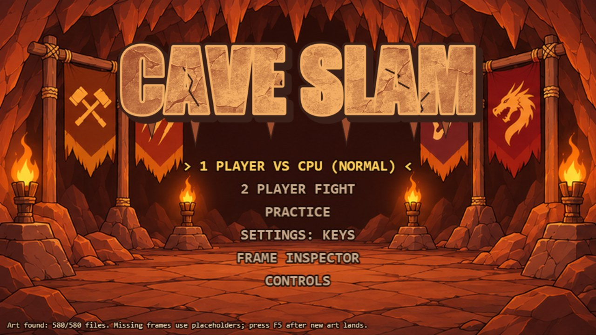
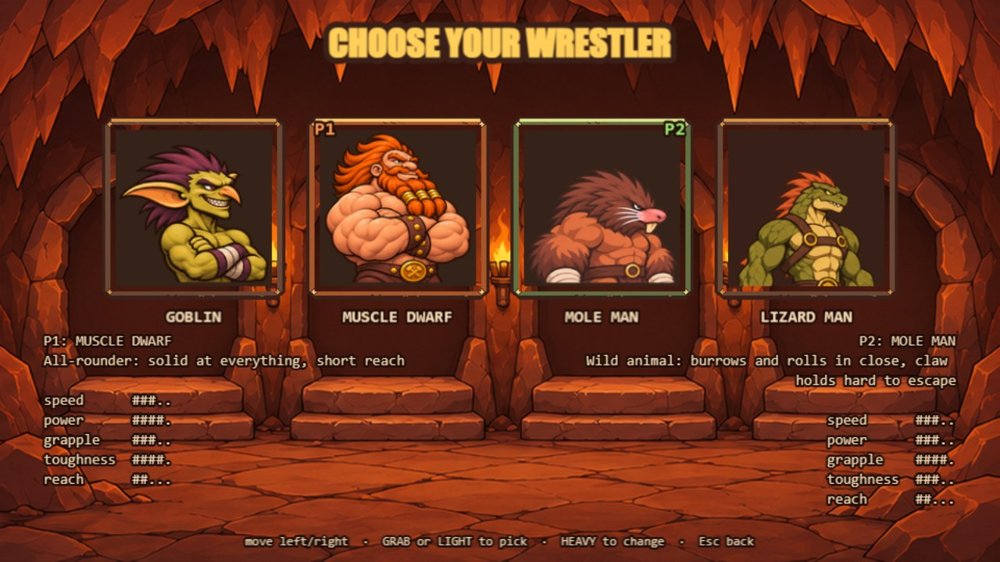
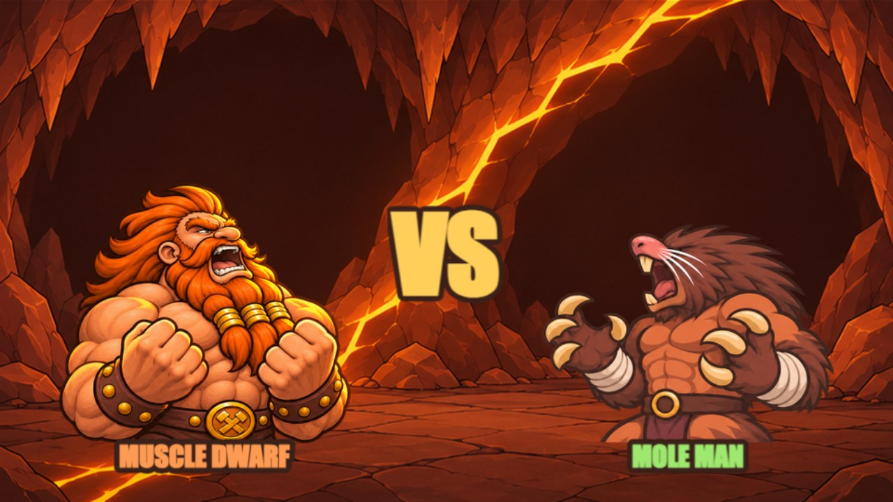
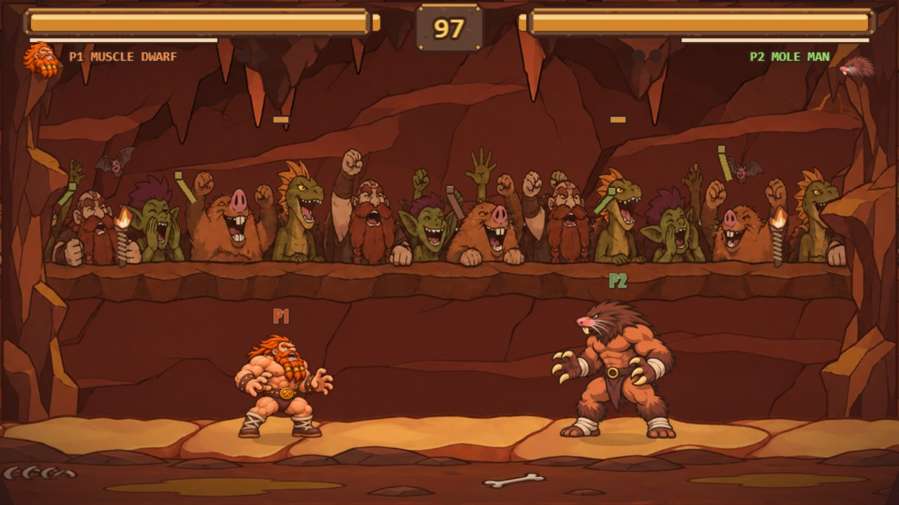
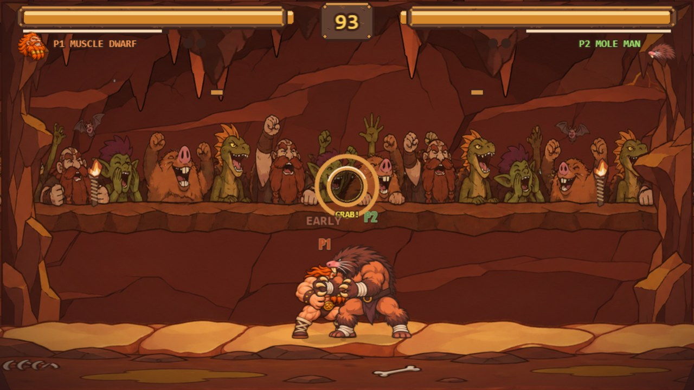
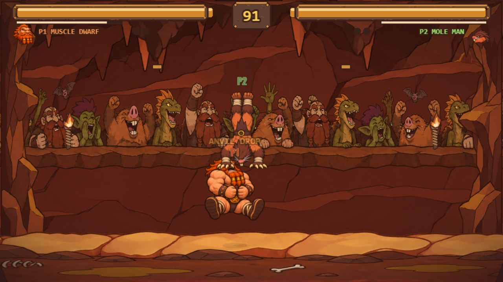
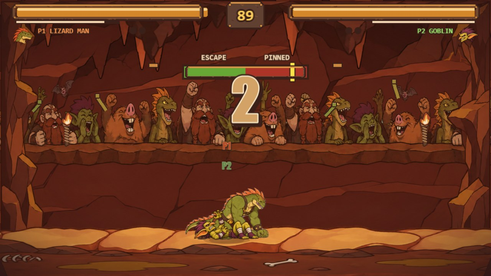
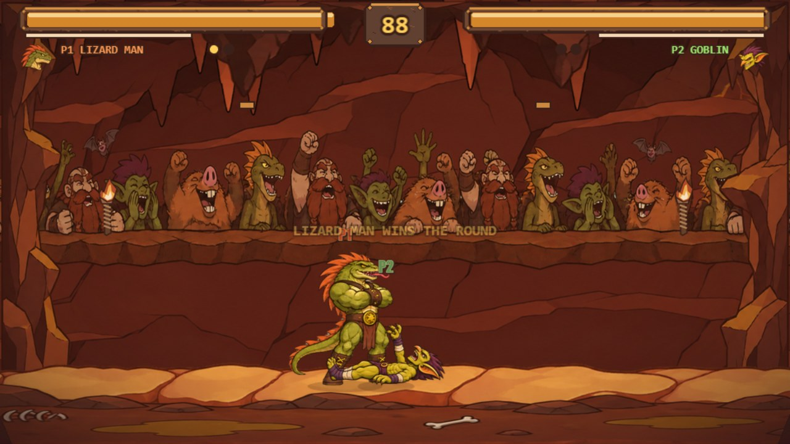
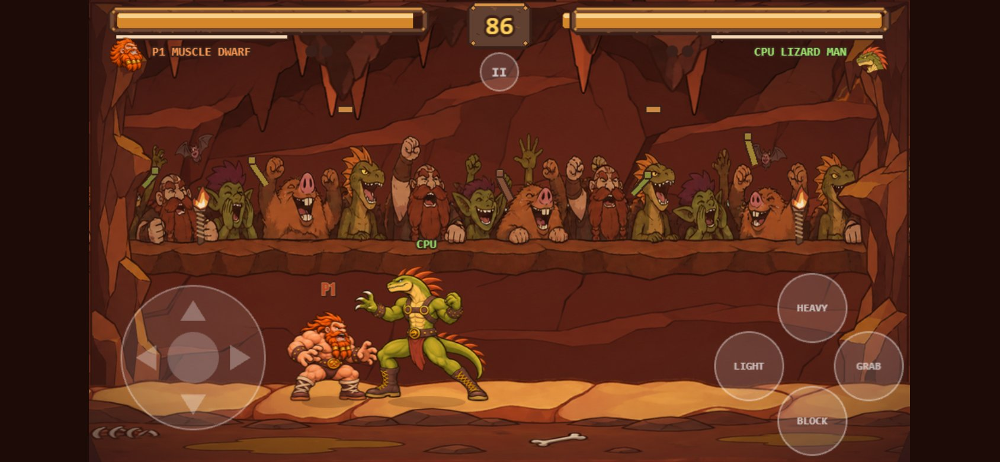

# Cave Slam

**Fantasy wrestling in a cave.** Pick a Goblin, a Muscle Dwarf, a Mole Man or
a Lizard Man, lock up in the middle of the cave, win the timing ring and slam your
opponent into the rock floor. Pin them for the 1-2-3 while the crowd of cave tribes goes wild.

**▶ Play it in your browser: https://leafcutterlabs.github.io/caveslam/**

Nothing to install. Play **1 Player vs CPU** (easy, normal or hard), or two people share one
keyboard or plug in gamepads. It also plays on **phones and tablets** with on-screen touch controls.



## Screenshots

| | |
| --- | --- |
|  Choose your wrestler: four fighters with different speed, power, grapple, toughness and reach. |  Muscle Dwarf vs Mole Man. |
|  Round 1 in the cave arena. Best of 3, 99 seconds a round. |  The lock-up: both players press GRAB as the ring closes. Better timing wins. |
|  The winner throws. The dwarf's signature move is the Anvil Drop. |  Roll-up into a pin. A tug-of-war meter decides if the count reaches 3. |
|  Lizard Man wins the round by pinfall. |  On a phone: 1 Player vs CPU with see-through touch controls. |

## How to play

The goal is to win two rounds, by knockout or by pinfall (if time runs out, the most health wins).

### 1 Player vs CPU

Pick **1 Player vs CPU** on the title menu. You are Player 1 and the CPU takes a different
wrestler with the same moves and rules. Press Left or Right on that menu line to choose
easy, normal or hard; the game remembers your choice.

### On a phone or tablet

Open the play link above and turn the phone sideways. A see-through d-pad (left) and
LIGHT / HEAVY / GRAB / BLOCK buttons (right) appear and control Player 1 in menus and fights.
Up on the d-pad jumps, and you can hold a direction while tapping a button. The first tap asks
for full screen, and the II button pauses a fight. Add `?touch` to the address to force the
controls on (or `?touch=0` to hide them).

### Keyboard and gamepad

| | Player 1 | Player 2 | Gamepad |
| --- | --- | --- | --- |
| Move | A / D | Left / Right | Stick or d-pad |
| Jump | W | Up | B or up |
| Crouch | S | Down | Down |
| Light strike | F | , or Numpad 1 | X |
| Heavy strike | G | . or Numpad 2 | Y |
| Grab | H | / or Numpad 3 | A |
| Block | R | M or Numpad 0 | Bumpers |

Keys can be remapped from **Settings: Keys** on the title menu. In menus, GRAB or LIGHT picks
and HEAVY goes back. In a fight, Esc pauses.

### Moves

- **Lock-up:** press GRAB next to your opponent. A ring shrinks; both players press GRAB as it
  closes. Hold a direction to choose the throw: forward for your signature slam, back to slam
  behind you, down for a roll-up pin, nothing for a body slam.
- **Reversal:** a PERFECT press by the defender turns the throw around.
- **Strikes set up grabs:** a stunned, dizzy or webbed opponent can be thrown with no lock-up.
- **Pins:** Down + GRAB on a downed opponent. The pinner mashes to hold, the pinned player mashes to escape.
- **The cave fights back:** hang from stalactites, wall-jump off the rock, and watch out for
  cave-ins, a web-spitting spider and a bottle of baby oil that makes you impossible to hold.

Want to try moves alone? **Practice** on the title menu has no timer and refills health.
The full move list is in [software/README.md](software/README.md).

## Run it on your own computer

You need the whole repository: the game in `software/` loads its art and sound from `assets/`.

1. Download the code: click **Code → Download ZIP** on GitHub and unzip it, or run
   `git clone https://github.com/LeafCutterLabs/caveslam.git`.
2. Start the local server:
   - **Windows:** double-click `software/start.bat`. It needs nothing installed and opens the game
     in your browser. Close the black window to stop it.
   - **Mac, Linux or Windows with Python 3:** from the `software` folder run
     ```
     python serve.py
     ```
     then open http://localhost:8080/software/
3. Pick **2 Player Fight** and go.

Opening `index.html` straight from the file system does not work, because browsers block
images loaded from `file://`. Use one of the servers above.

Handy URL shortcuts: `?p1=goblin&p2=dwarf` jumps straight into a match, `?cpu=hard&p1=goblin&p2=lizard` into a CPU fight, and
`?practice&p1=mole&p2=lizard` straight into practice.

## What's in this repository

| Folder | What it holds |
| --- | --- |
| `software/` | The game: Phaser 3 (bundled, works offline) and the source in `software/src/` |
| `assets/` | Sprites, atlases, stage art, effects, UI and audio the game loads |
| `media/` | Original concept art and character study sheets |
| `docs/screenshots/` | The screenshots above |
| `CAVE_SLAM_ASSET_PROMPTS.md` | The art brief: style rules and a prompt for every asset |

Cave Slam is a work in progress, and new art is still being added. Missing frames are drawn as
simple placeholders, so the game always runs. Every push to `main` redeploys the browser version
through GitHub Pages (`.github/workflows/pages.yml`).

## Feedback

Found a bug or have an idea? Open an issue and say which wrestlers you were playing and what happened.
